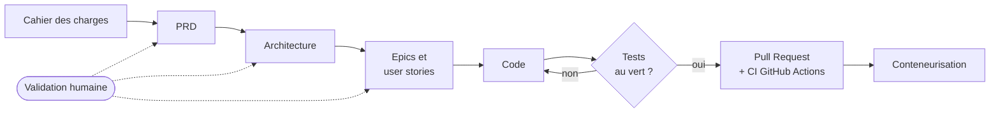

<h1 align="center">Haithem Hammami</h1>

  <strong>Ingénieur logiciel — IA agentique, LLM et systèmes multi-agents</strong> 
  Élève ingénieur en dernière année, Génie Logiciel — ESPRIT (Tunis)

  
  
  

---

## Profil

Élève ingénieur en dernière année de Génie Logiciel à ESPRIT (école accréditée CTI), je me spécialise dans l'IA agentique et les grands modèles de langage. Mon projet principal, **Foundry**, est une plateforme où des agents IA prennent en charge la conception, le développement, les tests et la documentation d'une application à partir d'un cahier des charges, sous validation humaine à chaque étape.

Je m'appuie sur un socle solide en Python, FastAPI, Java/Spring, SQL, Docker et CI/CD, ainsi que sur une expérience pratique en MLOps.

Je recherche un **stage de fin d'études (PFE) en IA agentique**, à partir de début 2027.

---

## Projet principal

### [Foundry](https://github.com/Heythaam/foundry) — Génération d'applications par IA agentique
*Octobre 2026 – en cours*

  
  
  

Plateforme multi-agents qui automatise le cycle de développement logiciel de bout en bout. Chaque phase est confiée à un agent LLM spécialisé, avec une validation humaine entre les étapes.

- **Génération incrémentale** : code produit story par story dans des sessions d'agent isolées, avec injection du contexte (story, critères d'acceptation, architecture). Aucun commit sans tests automatisés au vert.
- **Human-in-the-loop** : point de validation à chaque phase, revue préalable des exigences (contradictions, manques) et escalade humaine en cas d'échec.
- **Intégration GitHub** : création du dépôt, une branche et une Pull Request par epic, fusion conditionnée à une CI GitHub Actions réussie ; README, licence et documentation de planification générés.
- **Fiabilité et traçabilité** : classification des échecs, retry avec backoff exponentiel, reprise après crash (SQLite WAL), journal d'actions append-only signé SHA-256 et versionné dans Git.
- Plus de **900 tests** pytest.

`Python` `asyncio` `LLM` `Systèmes multi-agents` `SQLite` `Docker` `GitHub Actions` `pytest`

---

## Expérience professionnelle

### Stage Ingénieur MLOps — TALYS
*Juillet 2026 – Août 2026*

Conception d'un pipeline ML complet de détection de fraude bancaire sur 6,3 millions de transactions.

- Ingestion PySpark, comparaison de cinq modèles suivie dans MLflow, explicabilité SHAP et seuil de décision optimisé selon une fonction de coût métier ; orchestration Airflow.
- Génération de données synthétiques conformes au RGPD : simulation multi-agents, puis CWGAN (PyTorch).
- Exposition du modèle via une API FastAPI déployée sur Kubernetes, supervisée avec Prometheus et Grafana.
- Chaîne CI/CD GitHub Actions (lint et tests, build et push Docker, redéploiement) ; pylint 10.00/10 ; sept ADR rédigés.

`Python` `FastAPI` `PySpark` `PyTorch` `XGBoost` `SHAP` `MLflow` `DVC` `Airflow` `Kubernetes` `Prometheus` `Grafana`

---

## Autres projets

### [logtldr](https://github.com/Heythaam/logtldr) — Résumé d'incidents à partir de logs bruités
*Novembre 2026 – en cours*

  
  
  

Outil en ligne de commande qui transforme des milliers de lignes de logs (Kubernetes, Docker, CI) en un résumé d'incident court : chronologie, cause probable et points à vérifier. Le principe : **le LLM propose, le code vérifie**. Chaque affirmation est rattachée à une ligne de log exacte, et la confiance est plafonnée par des règles déterministes.

- **Confidentialité** : masquage des clés AWS, JWT, chaînes de connexion et adresses avant tout traitement, avec des identifiants stables ; mode `--local` qui interdit tout appel réseau.
- **Compression** : regroupement des lignes répétitives par templates (Drain3), détection de la première anomalie plutôt que de la première erreur.
- **Refus de deviner** : pas d'appel au LLM si les logs sont sains ou trop pauvres en signal.
- **Vérification** : chaque citation est contrôlée contre les logs ; une hypothèse sans preuve valide est écartée.
- **Évaluation** : jeu de 10 cas (LogHub, échecs CI pytest/Docker/npm, cas trompeurs et logs sains) avec scoreur automatique.

`Python` `LiteLLM` `Ollama` `Drain3` `Pydantic` `pytest`

### [NexusML](https://github.com/Heythaam/NexusML) — Plateforme de gestion du cycle de vie ML
*2026 – en cours*

Application full-stack pour piloter des pipelines Airflow et un registre de modèles MLflow.

- Backend en microservices Spring Cloud (Config Server, Eureka, API Gateway réactive, services Identity, Pipeline et Model).
- Sécurité Keycloak (OIDC/JWT) avec contrôle d'accès par rôles ; chiffrement AES-256-GCM des identifiants tiers.
- Architecture événementielle RabbitMQ : rechargement à chaud des connexions Airflow/MLflow et journal d'audit distribué.
- Frontend Angular 18 modulaire, sans bibliothèque de composants externe.

`Java 21` `Spring Boot` `Spring Cloud` `Angular 18` `TypeScript` `Keycloak` `RabbitMQ` `PostgreSQL` `Docker`

### [Data Lakehouse from Scratch](https://github.com/Heythaam/data-lakehouse-from-scratch)
*Septembre 2026*

Lakehouse inspiré de l'architecture Databricks, construit sans base de données traditionnelle.

- 38,3 millions de lignes (NYC Taxi 2023) ingérées par un pipeline idempotent.
- Requêtes SQL avec partition pruning : 83 % des données ignorées, `COUNT(*)` en 0,13 s.
- Tests de résilience (perte d'un nœud en cours de requête) et correction de dérives de schéma réelles ; 28 tests unitaires.

`MinIO` `Apache Iceberg` `Nessie` `Trino` `PyIceberg` `Python`

### JungleInEnglish — Plateforme e-learning *(projet académique)*

Plateforme d'apprentissage de l'anglais en microservices Spring Cloud, sécurisée par Keycloak, avec génération de contenu pédagogique via LLM (Gemini) et chaîne DevOps Jenkins, Docker, Kubernetes et SonarQube.

---

## Stack technique

<strong>Langages et développement applicatif</strong>

  

<strong>IA, machine learning et données</strong>

  

  
  
  
  
  
  

<strong>DevOps et MLOps</strong>

  

  
  
  
  
  

---

## Formation

**Cycle ingénieur en Génie Logiciel** — ESPRIT, Tunis *(école accréditée CTI, diplôme reconnu en France)*
Septembre 2022 – Juin 2027

## Langues

Arabe (langue maternelle) · Français C1 (TCF 517/699) · Anglais professionnel (TOEIC 810/990)
